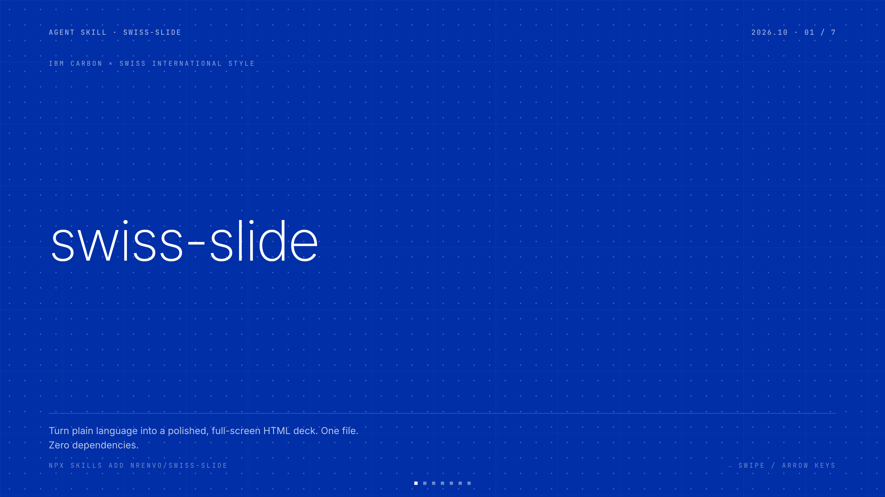
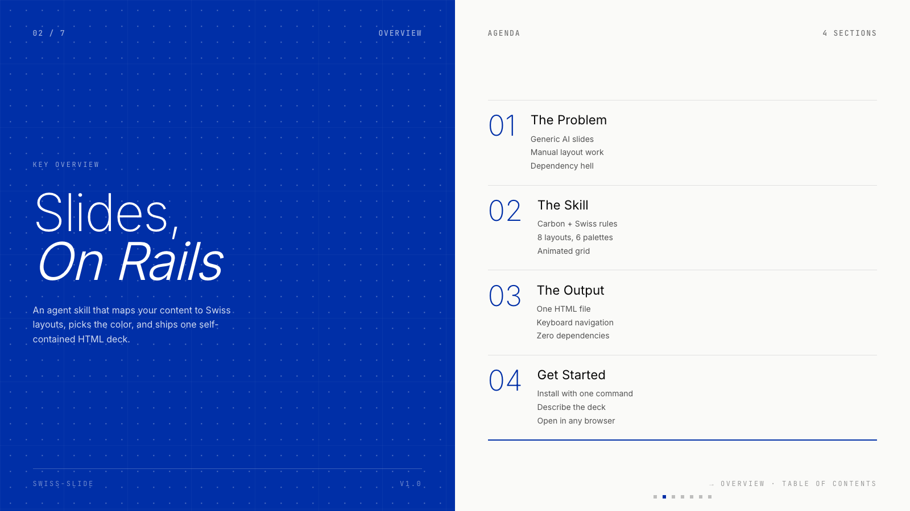
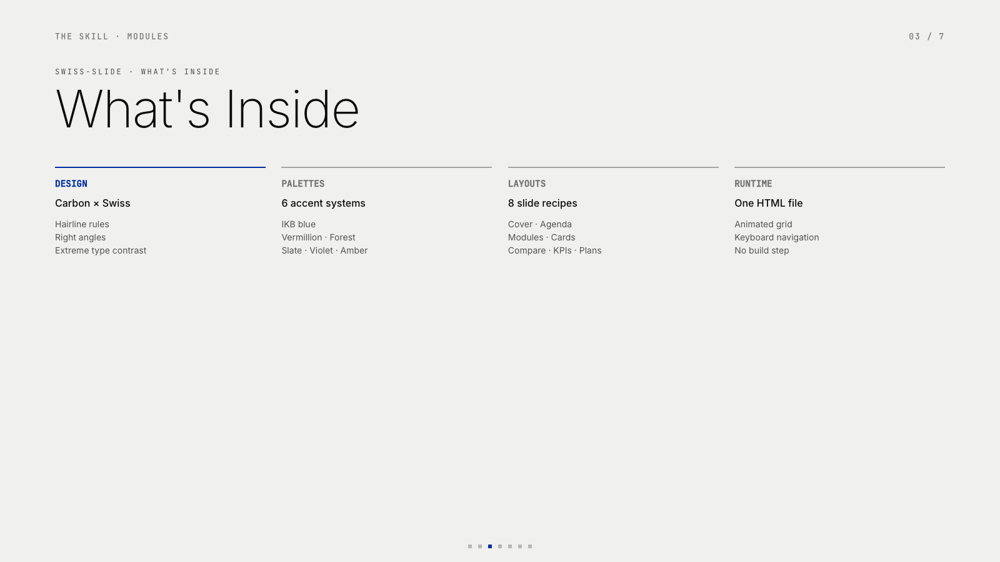
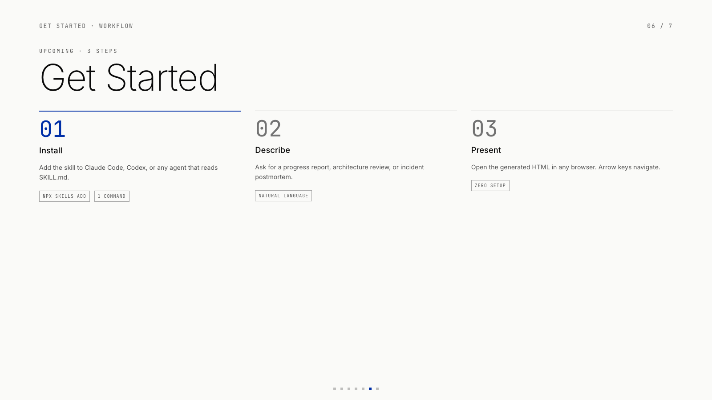
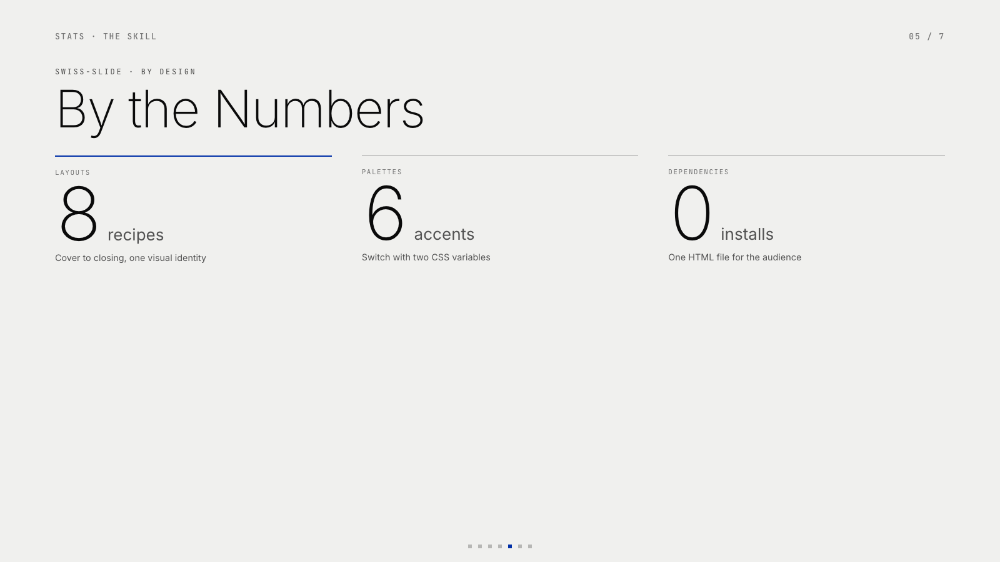

<p align="center">
  <h1 align="center">swiss-slide</h1>
</p>

<p align="center">
  <a title="License" href="./LICENSE"></a>
  <a title="Agent Skill" href="https://github.com/nrenvo/swiss-slide"></a>
</p>

<p align="center">
  <strong>IBM Carbon + Swiss International Style</strong> &mdash; polished work-report decks from natural language.<br>
  One HTML file. No dependencies. Opens in any browser.
</p>

[中文](./README.zh-CN.md)



---

## What is this?

An **agent skill** — works with Claude Code, Codex, and any platform that supports the skill format. Describe what you need in plain language &mdash; a weekly update, quarterly review, architecture review, or incident postmortem &mdash; and swiss-slide generates a complete, presentation-ready HTML report.

---

## Screens

| | |
|---|---|
|  |  |
|  |  |

---

## Features

<table>
<tr><td width="180"><strong>6 Accent Palettes</strong></td><td>IKB Klein Blue (default), Vermillion, Forest, Slate, Violet, Amber. Switch by changing two CSS variables.</td></tr>
<tr><td><strong>8 Slide Layouts</strong></td><td>Cover, Agenda (split), Modules, Cards, Before/After, Plans, Closing, KPIs &mdash; each with a distinct visual identity.</td></tr>
<tr><td><strong>Animated Grid</strong></td><td>Drifting dot-and-rule grid on cover and accent slides, pure CSS — no canvas, no external code.</td></tr>
<tr><td><strong>Keyboard Navigation</strong></td><td>&larr; &rarr; or spacebar, with square dot indicators. Smooth scroll-snap between slides.</td></tr>
<tr><td><strong>Responsive Typography</strong></td><td>Viewport-scaled type &mdash; Inter, JetBrains Mono, with CJK fallback. Extreme size contrast per Swiss design rules.</td></tr>
<tr><td><strong>Zero Dependencies</strong></td><td>One self-contained HTML file. Share it, open it, present it. Nothing to install for your audience.</td></tr>
</table>

---

## Quick Start

```bash
npx skills add nrenvo/swiss-slide --skill swiss-slide
```

Then:

```
> Make a slide deck for our Q4 infrastructure migration postmortem

> Turn my meeting notes into a presentation

> Create an architecture review deck from this design doc
```

The skill maps your content to the right layouts, picks colors, and handles all typography. You get a `.html` file back.

---

## Slide Layouts

| # | Layout | Best for |
|---|--------|----------|
| R01 | **Cover** | Full-bleed accent opener &mdash; one headline, one tagline |
| R02 | **Agenda** | Split: summary statement + numbered section list |
| R03 | **Modules** | Four-column horizontal list &mdash; project breakdowns, deliverables |
| R04 | **Cards** | Four-card grid &mdash; features, parallel workstreams |
| R05 | **Before/After** | Dark contrast &mdash; migrations, refactors, security upgrades |
| R08 | **KPIs** | Stats with large numerals on grey surface |
| R06 | **Plans** | Three-column next-steps, first column accent-bordered |
| R07 | **Closing** | Mirrors the cover &mdash; accent full-bleed, thank-you slide |

---

## Design Rules

Swiss International Style, applied through an IBM Carbon lens:

> Right angles. Hairline rules. Extreme size contrast. Generous whitespace. No shadows. No rounded corners.

| Token | Light | Dark |
|-------|-------|------|
| Surface | `#fafaf8` (warm off-white) | `#0a0a0a` (near-black) |
| Accent | `#002FA7` (IKB Klein Blue) &mdash; configurable | |
| Type | Inter · JetBrains Mono · system CJK | |
| Grid | 6-column, 2.4vh gaps | |

---

## File Structure

```
swiss-slide/
├── SKILL.md                  ← The skill (trigger rules + workflow)
├── assets/
│   └── template.html          ← CSS/JS shell, animated grid, navigation
├── references/
│   ├── slide-recipes.md       ← R01–R08 complete HTML blocks
│   └── design-tokens.md       ← Token reference, type scale, components
├── README.md
├── README.zh-CN.md
└── LICENSE
```

---

## Contributing

This is an open-source project. Found a bug or have an idea?

1. Open an [issue](https://github.com/nrenvo/swiss-slide/issues)
2. Fork the repo, make your changes, and open a PR
3. Keep it simple &mdash; this skill values brevity and visual clarity
